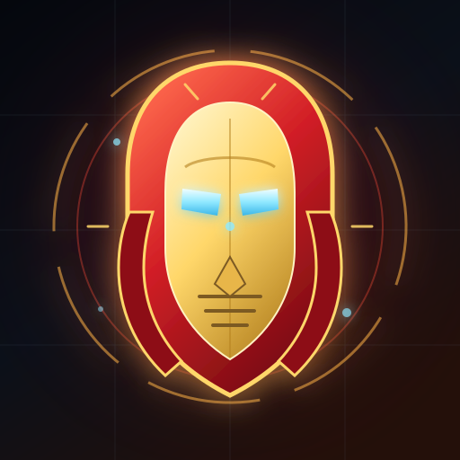

<div align="center">
  
  <h1>PROTOCOL: WARFORGE <sup>2.1</sup></h1>
  <p><strong>Iron Man leads. War Machine follows. The swarm breaks.</strong><br>
  A zero-dependency, browser-native arena survival game.</p>
  <p>
    <a href="https://firstgametesting.vercel.app"><strong>▶ PLAY THE LIVE BUILD</strong></a>
    ·
    <a href="docs/GAMEPLAY.md">Gameplay guide</a>
    ·
    <a href="docs/ARCHITECTURE.md">Architecture</a>
  </p>
</div>

---

## What is PROTOCOL: WARFORGE?

PROTOCOL: WARFORGE is a fixed-16:9 arena survival game built around two armored
heroes: you fly as **Iron Man**, and **War Machine** fights beside you as a fully
autonomous wingman. There is no levelling, no XP bar, no draft and no ability
menu. Your build is the **armor mark** you choose in the command deck plus the
**five-weapon rack** you cycle in the field.

Runs use a locked **1280×720 logical stage**, letterboxed and scaled to any
screen, capped at 1600×900. The game requests fullscreen and landscape lock when
a mission launches. Touch, keyboard/mouse and gamepad share one semantic input
layer, with a floating left-thumb joystick and a large right-hand action cluster
designed for phones.

Everything runs on **vanilla ES modules, Canvas 2D, and WebAudio**. No build
step, no runtime packages, no network calls.

## Highlights

| System | What it does |
| --- | --- |
| **Armor marks** | Mark III, Mark XLII, Hulkbuster, and unlockable Bleeding Edge each inject a distinct opening profile. |
| **Five-weapon rack** | Repulsor, Unibeam, Micro Missiles, Arc Chain, and Plasma Scatter are all available from second one. |
| **War Machine** | Autonomous minigun bursts and shoulder missiles; he rebuilds eight seconds after going down. |
| **Heat management** | Firing builds reactor heat. Overheat locks the weapon until the suit cools, so feather the trigger or swap guns. |
| **Missile barrage** | A cooldown-gated shoulder pod volley with homing and splash damage. |
| **Combo scoring** | Chained kills scale score up to 4×; taking a hit cuts the chain in half. |
| **Threat + bosses** | The arena escalates every 45s and a heavy unit arrives every 105s. |
| **Fixed 16:9 stage** | Logical 1280×720 render target with a letterboxed stage, responsive em-scaled UI, and adaptive internal resolution. |
| **Mobile controller** | Floating joystick, FIRE / MSL / DASH / SWAP cluster, auto-aim and auto-fire on by default for touch and pad. |
| **Offline PWA** | Installable, precached app shell, generated 192/512/maskable icons. |

## Quick start

Requires **Node.js 18+** (or any static file server).

```bash
git clone https://github.com/ayan27612-oss/Game1.git
cd Game1
npm start
# open http://127.0.0.1:8080
```

`npm start` runs the included zero-dependency static server. Python works too:

```bash
python3 -m http.server 8080
```

A local server is required because the game uses ES modules and a service
worker; opening `index.html` through `file://` will not work.

### Debug hooks

Append `?debug` to expose `window.__PROTOCOL_WARFORGE__` with the live
game/save/menu/HUD handles, lifecycle helpers, and renderer sizes.

- `?debug` — debug handle and lifecycle helpers
- `?nogamepad` — skip Gamepad API polling (useful in headless browsers)
- `F` — FPS / frame-time / entity telemetry
- `` ` `` — quadtree visualization

## Controls

| Action | Keyboard / mouse | Gamepad | Touch |
| --- | --- | --- | --- |
| Move | `WASD` / arrow keys | Left stick | Floating left joystick |
| Aim | Mouse | Right stick | Auto-aim, or drag the right thumb |
| Fire | Hold left mouse button | RT / RB | FIRE button or auto-fire |
| Missile barrage | `R` | B / Circle | MSL button |
| Dash | `Space` / `Shift` | A / Cross | DASH button |
| Swap weapon | `Q` / `E`, or `1`–`5` | X / Square | SWAP button |
| Pause | `P` / `Esc` | Start | HUD pause button |
| Scanlines | `T` | — | HUD / Settings |
| Mute | `M` | — | HUD / Settings |
| Fullscreen | — | — | HUD FS button |

On touch and gamepad, auto-aim and auto-fire are enabled by default. You can
disable them in **Settings → Controls**. The touch layout uses a floating left
stick anywhere in the left half of the stage and a right-thumb aim drag anywhere
in the right half that is not an action button.

## Game systems

### Armor marks

A mark is permanent for the run and selected before deployment. It is the whole
build; there is nothing to level and nothing to draft mid-run.

| Mark | Role | Opening profile |
| --- | --- | --- |
| **Mark III** | Balanced | +30 hull, +4% armor, +5% fire rate |
| **Mark XLII** | Strike | +16% damage, +8% fire rate, +6% crit, +4% speed, −10 hull |
| **Hulkbuster** | Siege | +60 hull, +14% armor, +1 missile, +10% missile damage, −8% fire rate, −6% speed |
| **Bleeding Edge** | Prototype | +1 dash charge, +10% speed, +8% crit, +0.05s i-frames, −15 hull |

Bleeding Edge is unlocked permanently in the Fabricator. Base hull is 140, so a
fresh Mark III suit starts at 170 and the Reinforced Plating unlock takes it to
195.

### Weapon rack

| # | Weapon | Character |
| --- | --- | --- |
| 1 | **Repulsor** | Twin palm bolts. Fast, accurate, low heat. |
| 2 | **Unibeam** | Chest reactor lance. Heavy damage, wide pierce, slow cycle. |
| 3 | **Micro Missiles** | Shoulder micro-missiles. Homing and splash damage. |
| 4 | **Arc Chain** | Arc discharge that jumps between nearby targets. |
| 5 | **Plasma Scatter** | Wide close-range burst. Devastating at point blank. |

Every weapon is available from the first second. SWAP cycles the rack, keys 1–5
select directly, and the HUD rack highlights the active gun and its heat state.

### Combat and scoring

- Kills add score scaled by the combo multiplier `1 + combo × 0.04`, capped at
  **4×** at 75 kills.
- The chain timer is 3.4 seconds. Taking damage halves the chain.
- Threat rises every 45 seconds, increasing spawn pressure and elite chance.
- Heavy units arrive every 105 seconds and scale with each encounter.
- Salvage earned at run end:
  `floor((score / 100 + threat × 8 + kills × 0.5) × salvageMultiplier)`.
- Aborting a run still banks the salvage earned so far.

### Enemy roster

| Enemy | Threat |
| --- | --- |
| **Swarmer** | Fast filler that closes distance in packs. |
| **Sniper** | Locks a telegraphed line before firing; dash or break the line. |
| **Hex** | Anchors area denial with rotating bullet patterns. |
| **Bomber** | Detonates on death; respect the blast radius. |
| **Splitter** | Splits into two smaller swarmers when killed. |
| **Weaver** | Weaves lateral bullet curtains and cuts off escape lanes. |
| **Gunner** | Sustained ranged pressure with tracking bursts. |
| **Elites** | Armored, Volatile, or Swift affixes with auras and bonus drops. |
| **Bosses** | Multi-phase health bars, radial attacks, and summoned escorts. |

## Project structure

```
.
├── index.html              # semantic shell: HUD, command deck, pause, game over
├── style.css               # fixed-stage design system + responsive em scaling
├── manifest.json           # installable PWA metadata
├── sw.js                   # cached app shell + offline fallback
├── server.js               # zero-dependency local static server
├── src/
│   ├── main.js             # stage sizing, state machine, loop, UI wiring
│   ├── Game.js             # simulation: director, combat, scoring, camera
│   ├── engine/             # math, quadtree, projection, WebAudio synth
│   ├── entities/           # Iron Man, War Machine, enemy roster, bosses
│   ├── systems/            # armor marks, weapons, cosmetics, particles, saves
│   └── ui/                 # input, command deck, HUD, touch overlay
├── test/                   # node:test unit and module-import suites
├── tools/                  # development-only icon renderer
├── docs/                   # gameplay, architecture, deployment notes
└── .github/workflows/ci.yml
```

## Development

```bash
npm test        # node:test suites (save schema, game lifecycle, modules, engine)
npm run check   # syntax checks + manifest + service-worker precache validation
npm run icons   # regenerate PWA PNGs (requires Python 3, Pillow, NumPy)
```

There is no bundler and no install step. `npm test` runs directly against the
same ES modules the browser loads.

### Adding content

1. Add a weapon to `WEAPONS` in `src/systems/Weapons.js` and give it a unique
   `id`, `key`, heat cost and `fire` pattern.
2. Add an armor mark to `ARMOR_MARKS` in `src/systems/Doctrines.js`, including a
   legacy alias in `LEGACY_MARK_MAP` if it replaces an older id.
3. Add a permanent unlock to `META_UNLOCKS` in `src/systems/Upgrades.js`.
4. Run `npm test` and `npm run check`.
5. If you add a runtime module, add it to `APP_SHELL` in `sw.js` and bump
   `VERSION` there for a release.

See [docs/ARCHITECTURE.md](docs/ARCHITECTURE.md) for the full system map and
rendering pipeline.

## Deployment

The build is plain static files. Any static host works:

- **Vercel** — import the repo, framework preset **Other**, output directory `.`
- **GitHub Pages** — publish the repository root
- **Netlify / Cloudflare Pages** — no build command, publish directory `.`

The included `server.js` is for local development and self-hosting via Node; it
adds MIME types, ETags, security headers, and cache policy. It is not required
by static hosts.

For a release, update `VERSION` in `sw.js` so returning players fetch the new
precache, then redeploy. `npm run check` verifies every precached path exists.
See [docs/DEPLOYMENT.md](docs/DEPLOYMENT.md) for host configuration, release
steps, and offline verification.

## Save data and privacy

Progress is stored in `localStorage` under `protocol_warforge_save_v3` using
schema **v4**. Saves from `protocol_swarm_save_v2` and `protocol_swarm_save_v1`
migrate automatically, including old doctrine ids and unlock names. Nothing is
uploaded: there is no analytics, account, or network dependency. Clearing site
data resets the Fabricator, high scores, cosmetics, and settings.

Settings include music/SFX volume, mute, auto-fire/auto-aim, screen shake,
damage numbers, reduced motion, CRT scanlines, and render quality (`auto` adapts
the internal resolution to frame rate while the logical stage stays 1280×720).

## Browser support

Modern evergreen browsers with ES modules, Canvas 2D, and WebAudio:

- Chrome / Edge 90+
- Firefox 90+
- Safari 15+

Gamepad support is optional and degrades gracefully. Fullscreen, orientation
lock, wake lock, and PWA installation depend on the browser; the game remains
fully playable without them.

## Credits

Design, code, and procedural art by the PROTOCOL: WARFORGE project. Iron Man and
War Machine are used here as fan-made thematic inspiration; this is a
non-commercial fan project. Built with Canvas 2D and WebAudio, with no
third-party runtime assets.
